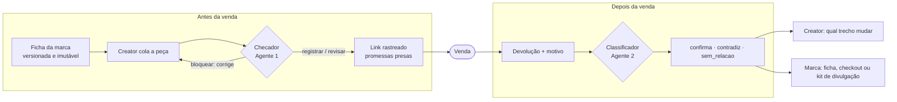
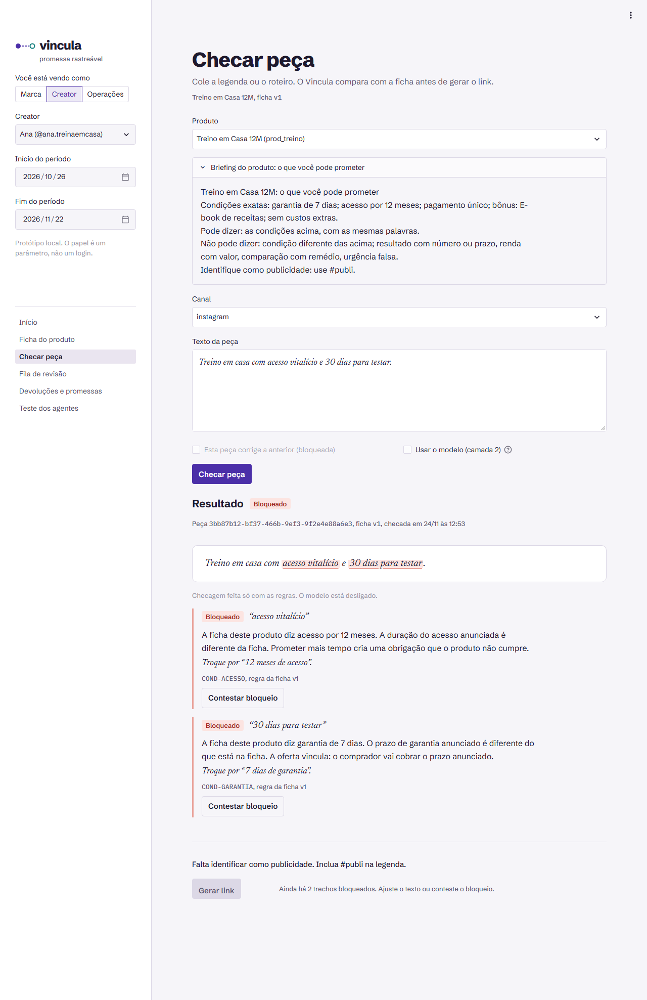
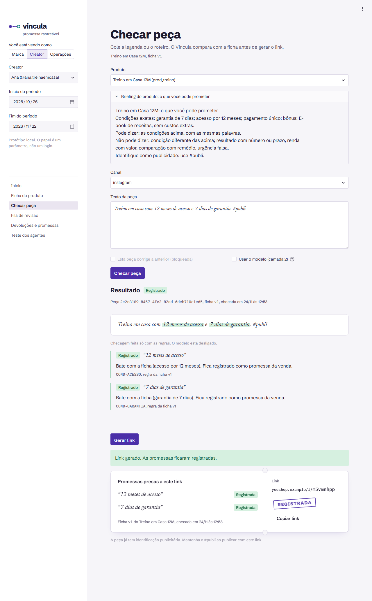
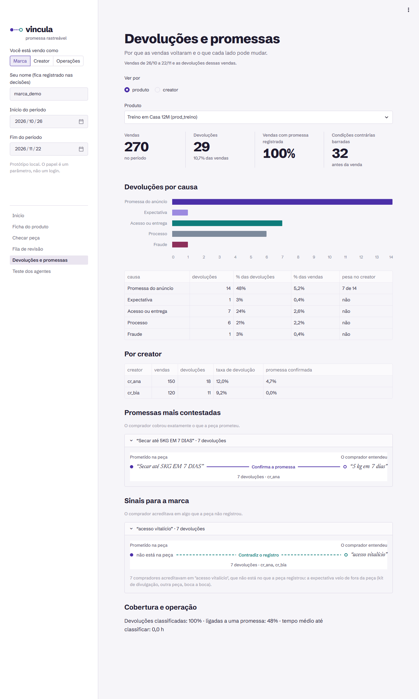
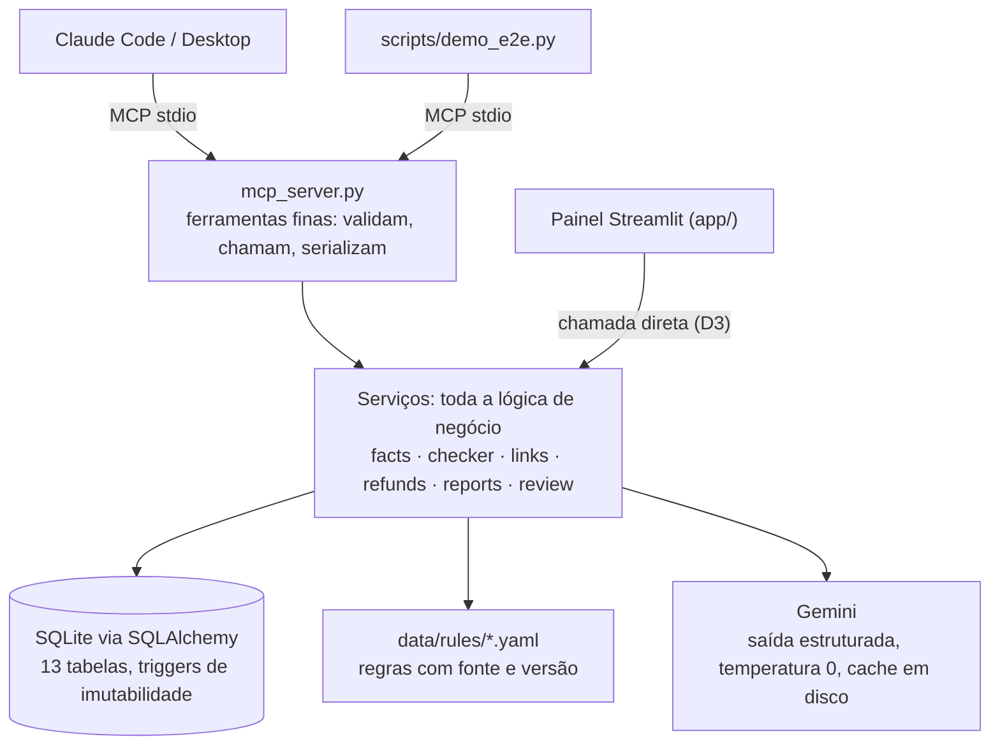

<div align="center">


# Vincula · promessa rastreável

**A promessa que vende é a promessa que vincula.**

Liga **o que o produto pode prometer**, **o que o creator prometeu** na peça que gerou a venda
e **por que o comprador pediu o dinheiro de volta**, e devolve isso a quem prometeu.

[](.python-version)
[](https://docs.astral.sh/uv/)
[](#-conectar-no-claude-code)
[](docs/decisoes.md)
[](#-o-painel)
[](tests/)
[](pyproject.toml)
[](../../tree/v0.1-mvp)

[O problema](#-o-problema) ·
[Como funciona](#-como-funciona) ·
[Em ação](#-em-ação) ·
[Resultados](#-resultados-do-teste-1) ·
[Rodar](#-começo-rápido) ·
[MCP](#-conectar-no-claude-code) ·
[Arquitetura](#-arquitetura) ·
[Limites](#-limites-do-mvp)

</div>

---

> [!TIP]
> **Para quem está avaliando:** em 10 minutos dá para ver o essencial.
> 1. Leia [O problema](#-o-problema) e [Como funciona](#-como-funciona) (2 min).
> 2. Veja as telas em [Em ação](#-em-ação) e os números em [Resultados](#-resultados-do-teste-1) (3 min).
> 3. Rode `uv run python tasks.py setup lint test` (sem rede, sem chave) e, com a chave do Gemini,
>    `uv run python tasks.py db-reset seed simulate demo` (5 min).
>
> As escolhas de projeto estão justificadas, uma a uma, em [docs/decisoes.md](docs/decisoes.md) (D1 a D40).

## 🎯 O problema

As plataformas de afiliados sabem **quem vendeu** e **por que o dinheiro voltou**, mas não ligam uma
coisa à outra, nem ao **que foi prometido**. As validações do case (H1 a H4) mostram o tamanho disso:

| | Evidência | Origem |
|---|---|---|
| 🗣️ | **1 em 4** compradores (25,6% de 172) reclama de promessa; quando diz onde foi convencido, **quase 2 em 3** (64,7%). | H1 |
| 📄 | **52%** das promessas explícitas são **condição da oferta**: vitalício, garantia, bônus. Caso real: anúncio com 30 dias de garantia, checkout com 7. | H1 |
| 🚩 | **55%** de 60 anúncios auditados têm indício de irregularidade; 4 usam alegação da lista proibida da Anvisa. | H2 |
| 🔍 | **0 de 9** plataformas diz o que *aquele* produto pode prometer; **0** confere a peça antes de publicar. | H3 |
| 🧩 | Hotmart, Kiwify e Eduzz têm a origem da venda e o motivo do reembolso, mas **não os ligam à promessa**. | H4 |

A afirmação que este MVP prova:

> **Dá para ligar, de forma automática e auditável, a devolução à promessa que gerou a venda e
> devolver isso a quem prometeu.**

## 💡 Como funciona

Quatro módulos, dois agentes de IA e um servidor MCP como porta de entrada:

| # | Módulo | O que faz |
|---|---|---|
| 1 | 📋 **Ficha do produto** | A marca declara, com versão, as condições da oferta e as alegações permitidas e proibidas, cada uma com a fonte. |
| 2 | 🔎 **Checador de conteúdo** (Agente 1) | Lê a peça e devolve, por trecho, `bloquear`, `revisar` ou `registrar`. Compara a condição anunciada com a da ficha. |
| 3 | 🔗 **Promessa registrada** | O link rastreado só nasce depois da checagem e carrega a peça e a versão da ficha. Cada venda herda isso. |
| 4 | 🧭 **Classificador de devolução** (Agente 2) | Classifica o motivo, liga à promessa registrada (`confirma`, `contradiz`, `sem_relacao`) e explica ao creator o que mudar. |



**Dois retornos, cada um para quem pode agir:** o creator muda a próxima peça; a marca corrige a
ficha, o checkout ou o kit de divulgação. Devolução por acesso, cobrança ou expectativa que **não
estava na peça** não pesa no creator.

## 📸 Em ação

O exemplo do guia, no painel. A ficha do **Treino em Casa** diz 7 dias de garantia e 12 meses de
acesso; a creator escreve *"acesso vitalício e 30 dias para testar"*.

<table>
  <tr>
    <td width="50%" align="center"><b>1 · A peça é bloqueada, com o porquê e a troca sugerida</b></td>
    <td width="50%" align="center"><b>2 · Corrigida, gera o link com as promessas presas</b></td>
  </tr>
  <tr>
    <td></td>
    <td></td>
  </tr>
</table>

<details>
<summary><b>3 · A marca vê por que as vendas voltaram e o que cabe a cada lado</b> (clique para abrir)</summary>
<br>
<p align="center">
  
</p>

"Secar até 5KG EM 7 DIAS" **confirma a promessa** da peça da cr_ana (pesa nela). "Acesso
vitalício" **contradiz o registro**: não estava em nenhuma peça, então vira **sinal para a marca**.
</details>

As 11 telas (visões de marca e creator) estão em [docs/capturas/P2/](docs/capturas/P2/).

## 📊 Resultados do Teste 1

Os dois agentes avaliados contra os gabaritos reais das validações: **60 anúncios** da auditoria H2
e **172 compradores** da H1. O split `test` é o principal; o `dev` serviu só para ajustar regras e
escolher exemplos. **Nenhuma meta não atingida foi escondida.**

| Agente | Meta do guia | Obtido (`test`) | |
|---|---|---|:---:|
| 🔎 Checador | Bloquear as 4 peças com alegação proibida pela Anvisa | **4 de 4** (dev + test) | ✅ |
| 🔎 Checador | Kappa no binário "indício" ≥ 0,6 | 0,37 (só regras) · 0,32 (com modelo) | ❌ |
| 🔎 Checador | Promessa verificável extraída ≥ 80% | 47% (só regras) · 71% (com modelo) | ❌ |
| 🧭 Classificador | Acurácia na causa principal ≥ 80% | **83%** | ✅ |
| 🧭 Classificador | Kappa na causa principal ≥ 0,6 | **0,77** | ✅ |
| 🧭 Classificador | Subtipo nas reclamações de promessa ≥ 70% | **74%** | ✅ |

**Critério de corte do guia (o classificador separa promessa de acesso e processo?): SIM.** 86% de
acerto e kappa 0,79 nas 121 reclamações do `test` dessas três classes.

<details>
<summary><b>Leitura crítica dos números</b></summary>
<br>

- **Checador:** só com regras, erra por omissão (87% de precisão, 61% de recall); com o modelo, erra
  por excesso (67% / 91%). O que mais pesa, as 4 alegações proibidas, é bloqueado nas duas
  configurações. Falta regra para emagrecimento sem número em infoproduto: todos os exemplos estão
  no `test`, então ela ficou de fora de propósito (D27).
- **Classificador:** o ponto fraco é a precisão de `promessa_explicita` (61%). Por isso o indicador
  do creator só conta `confirma` com a promessa registrada, confiança ≥ 0,8 e sem reversão humana (D30).
- **Vazamentos declarados:** as regras do checador nasceram da mesma auditoria que serve de
  gabarito; o texto da H1 é uma paráfrase de quem codificou; uma pessoa codificou os dois
  gabaritos. Os números indicam caminho, não desempenho de produção.

Relatório completo, matriz de confusão e próximos passos em [docs/resultados.md](docs/resultados.md);
saídas brutas em [eval/reports/](eval/reports/).
</details>

## 🚀 Começo rápido

### Requisitos

- [**uv**](https://docs.astral.sh/uv/): instala o Python 3.12 do projeto (fixado em
  `.python-version`) e as dependências. Não precisa de `make`: os comandos ficam em `tasks.py`.
- **Chave da API do Gemini** (`GEMINI_API_KEY`), plano gratuito basta. Sem chave, tudo funciona só
  com regras e textos fixos, exceto a classificação de devoluções, que vai para revisão humana.
- *Opcional:* [Claude Code](https://claude.com/claude-code) para conversar com o servidor MCP.

### Instalação

```bash
git clone https://github.com/Lucas-Ibanez/desafio-youshop.git && cd desafio-youshop
cp .env.example .env            # preencha GEMINI_API_KEY
uv run python tasks.py setup    # uv sync
```

### Passo a passo

```bash
uv run python tasks.py lint test                # ruff e 371 testes sem rede (~30 s)
uv run python tasks.py db-reset seed simulate   # banco, dados fictícios e 600 vendas simuladas
uv run python tasks.py demo                     # exemplo do guia de ponta a ponta pelo MCP
uv run python tasks.py painel                   # painel em http://localhost:8501
uv run python tasks.py eval                     # Teste 1 dos dois agentes (eval/reports/)
```

> [!NOTE]
> Tarefas em sequência param na primeira falha; `uv run python tasks.py help` lista todas.
> Nos documentos, `make <x>` significa `uv run python tasks.py <x>`.
> A primeira `simulate` chama o Gemini (cerca de 9 min na cota gratuita de 15 chamadas/min); as
> seguintes usam o cache em disco e levam cerca de 1 min. Sem chave, use
> `PROMESSA_SIMULATE_ARGS="--modo gabarito"`.

<details>
<summary><b>Todas as tarefas</b></summary>
<br>

| Tarefa | Faz |
|---|---|
| `setup` | `uv sync` |
| `lint` / `format` | ruff |
| `test` / `test-llm` | pytest sem rede (371) / só os testes que chamam o Gemini (28) |
| `db-reset` | apaga e recria `var/promessa.db` |
| `gold` | importa, anonimiza e confere os gabaritos (precisa de `data/raw/` e `docs/fontes/`, fora do git) |
| `seed` | 5 marcas, produtos, fichas v1 e creators fictícios |
| `simulate` | peças, links, 600 vendas e devoluções fictícias (`PROMESSA_SIMULATE_ARGS="--modo gabarito"` roda sem modelo) |
| `eval-checador` / `eval-classificador` / `eval` | Teste 1 contra os gabaritos da H2 e da H1 |
| `demo` | exemplo do guia pelo protocolo MCP, num banco só da demo (`var/demo.db`) |
| `painel` | painel Streamlit: marca, creator e Operações |
| `mcp` | servidor MCP em stdio (`python -m promessa.mcp_server`) |
</details>

### 🎬 A demo

`tasks.py demo` sobe o servidor MCP como subprocesso e percorre o exemplo do guia em 5 passos:

1. 📋 Ficha do Treino em Casa: 7 dias de garantia, 12 meses de acesso.
2. ⛔ Peça *"acesso vitalício e 30 dias para testar"* → **bloqueada**, com a regra e a troca sugerida.
3. ✅ Peça corrigida → **link gerado** com as promessas presas.
4. ↩️ Devolução *"perdi o acesso, achei que era para sempre"* → promessa / condição da oferta,
   **contradiz**, sem pesar na creator.
5. 📣 Relatório do produto com o sinal "acesso vitalício" para a marca.

Termina com **"Demo concluída"** e 9 verificações (cerca de 5 s com cache).

### 🧭 O painel

| Página | Para quem | O que faz |
|---|---|---|
| 1 · Ficha do produto | marca | versões, condições, regras com fonte, briefing, nova versão |
| 2 · Checar peça | creator | briefing, checagem com trechos marcados, link rastreado, contestação |
| 3 · Fila de revisão | marca, Operações | bloqueios contestados e classificações com confiança baixa |
| 4 · Devoluções e promessas | todos | marca e Operações por produto ou creator; creator só os próprios números e a explicação |
| 5 · Teste dos agentes | todos | metas e resultados do Teste 1 |

O papel é escolhido na barra lateral (não há login no MVP).

## 🤖 Conectar no Claude Code

```bash
claude mcp add promessa -- uv run --directory <caminho absoluto do repositório> python -m promessa.mcp_server
claude mcp list        # promessa: ... ✔ Connected
```

O servidor usa o banco de `PROMESSA_DB_URL` (padrão `var/promessa.db`): rode
`db-reset seed simulate` antes. São **9 ferramentas** (além de `ping`):

| Momento | Ferramenta | Para quê |
|---|---|---|
| Antes da venda | `get_product_facts` · `upsert_product_facts` | ler o briefing / criar nova versão da ficha |
| | `check_content` | checar a peça trecho a trecho |
| | `register_content_and_link` | registrar a peça e gerar o link rastreado |
| Depois da venda | `classify_refund` | classificar a devolução e ligá-la à promessa |
| | `get_promise_outcome_report` | relatório por produto ou creator |
| | `explain_refunds_to_creator` | explicação simples para o creator |
| Revisão humana | `list_review_queue` · `submit_review` | fila de bloqueios contestados e baixa confiança |

<details open>
<summary><b>💬 Três pedidos de exemplo</b> (respostas reais de 24/11/2026, resumidas)</summary>
<br>

> **"Confira esta legenda para o produto prod_magnesio, da creator cr_eli: 'Magnésio que seca
> barriga e turbina a imunidade! A vitamina B6 auxilia no funcionamento do sistema imune. Só hoje!'"**

Bloqueada: tirar "seca barriga" (emagrecimento não tem alegação aprovada) e "turbina a imunidade";
manter a frase da IN 28 com as palavras exatas; confirmar se a oferta é mesmo só hoje; incluir
`#publi`. Sugere uma legenda que passa.

> **"Por que as vendas da cr_ana estão voltando neste mês?"**

18 devoluções em 150 vendas: 7 pela promessa "Secar até 5KG EM 7 DIAS" (mudar o trecho); 3
esperavam "acesso vitalício", que não está na peça dela (sinal para a marca); 8 não têm a ver com
ela (acesso, reembolso, cobrança).

> **"Quais promessas sobre o prod_treino mais geram devolução?"**

Da creator: "Secar até 5KG EM 7 DIAS" (7, cr_ana). Sinal para a marca: "acesso vitalício" (7
compradores de cr_ana e cr_bia acreditavam nisso sem estar nas peças; conferir o kit de
divulgação). Acesso e reembolso não pesam na creator.
</details>

## 🧱 Arquitetura



### 🧠 Decisões que sustentam o produto

| Princípio | Na prática |
|---|---|
| **MCP é a porta; serviços são a lógica** | Nenhuma regra de negócio no `mcp_server.py` nem no painel: tudo em `src/promessa/*/service.py`. O mesmo servidor serve agentes externos na fase 2. |
| **Determinístico antes do modelo** | Regras baratas primeiro (listas da Anvisa, IN 28, condições da ficha, grafia disfarçada como `m0unj@r0`). O modelo entra onde a regra não alcança e **nunca rebaixa** uma decisão de regra. |
| **Regras são dados** | Listas, padrões e taxonomia em YAML versionado, com `fonte` e `referencia`. Trocar uma lista não muda código. |
| **Nada é editado, tudo é versão** | Ficha, peça e evento de revisão são imutáveis (garantido por triggers no banco). Isso prova o que valia no dia da venda: a oferta vincula (CDC, art. 30). |
| **Justo com o creator** | Só pesa no creator a devolução que **confirma** uma promessa registrada na peça dele, com confiança ≥ 0,8 e sem reversão humana (D30). O resto vira sinal para a marca ou para Operações. |
| **Nenhuma decisão automática tem consequência** | `bloquear` é um alerta forte. Contestação e decisão são humanas; cada saída grava origem, modelo, versão do prompt e quem revisou. |
| **Reprodutível** | Temperatura 0, cache em disco do modelo, simulador com semente fixa; `LLM_OFFLINE=true` roda só com o cache. |

### 🧰 Stack

**Python 3.12** · **uv** · SDK oficial **`mcp`** 2.x (stdio) · **Gemini** (`google-genai`, saída
estruturada com Pydantic) · **SQLite** + **SQLAlchemy 2** · **Pydantic v2** · **Streamlit** ·
**pandas** + **scikit-learn** (kappa de Cohen) · **pytest** + **ruff**.

<details>
<summary><b>📁 Estrutura do repositório</b></summary>
<br>

```
desafio-youshop/
├── src/promessa/            # pacote: toda a lógica
│   ├── facts/               #   ficha do produto (versões, briefing)
│   ├── checker/             #   Agente 1: regras determinísticas + camada do modelo
│   ├── links/               #   peça registrada e link rastreado
│   ├── refunds/             #   Agente 2: classificador e ligação com a promessa
│   ├── reports/             #   relatórios e explicação ao creator
│   ├── review/              #   fila e revisão humana
│   ├── rules/               #   carga, normalização e casamento das regras YAML
│   ├── llm/                 #   cliente Gemini, cache e prompts versionados
│   ├── db/                  #   modelos SQLAlchemy e sessão
│   └── mcp_server.py        #   servidor MCP (ferramentas finas)
├── app/                     # painel Streamlit (identidade Vincula em app/ui/)
├── data/
│   ├── rules/               # listas oficiais, padrões e taxonomia (YAML com fonte)
│   ├── seeds/               # marcas, produtos, creators e cenários fictícios
│   └── gold/                # gabaritos anonimizados da H1 e da H2, splits dev/test
├── eval/                    # Teste 1: métricas e relatórios
├── scripts/                 # seed, simulação, demo via MCP, gravação do vídeo
├── tests/                   # 371 testes sem rede + 28 que chamam o Gemini
├── docs/                    # contexto, plano, decisões, resultados, marca e capturas
└── tasks.py                 # todos os comandos do projeto
```
</details>

## 🧪 Qualidade

- ✅ **371 testes sem rede** (`tasks.py test`) e **28 que chamam o Gemini** (`tasks.py test-llm`,
  marcador `llm`), incluindo as invariantes de imutabilidade, os 15 casos do checador e a demo
  ponta a ponta pelo protocolo MCP.
- 🧹 **ruff** para lint e formatação.
- 🔁 **Clone limpo verificado:** `setup db-reset seed simulate demo` num diretório novo, sem cache,
  termina com "Demo concluída".
- 🔒 **Privacidade (LGPD):** gabaritos anonimizados; dados brutos com nomes ficam fora do git
  (`data/raw/`, `docs/fontes/`).

## 🚧 Limites do MVP

- **Dados:** vendas e devoluções são **simuladas** (sem dados da YouShop até a H5); produtos,
  marcas e creators são fictícios. A avaliação usa os gabaritos reais da H1 e da H2, codificados por
  uma pessoa.
- **Só texto:** sem vídeo, áudio ou imagem. A peça entra por envio voluntário (sem monitorar redes).
- **Nenhuma decisão automática tem consequência:** `bloquear` é um alerta forte; contestação e
  decisão são humanas; nada altera comissão ou alcance.
- **Não julga verdade científica:** compara com listas oficiais e com a ficha da marca. As alegações
  permitidas da IN 28 só cobrem magnésio e vitamina B6 (o suplemento fictício), e a página do PDF
  não pôde ser conferida.
- **Protótipo local:** sem login, multi-tenant ou nuvem; o papel é um parâmetro. O MCP está pronto
  para agentes externos, mas é interno no MVP.
- **Cota do Gemini (plano gratuito):** 15 chamadas/min e 500/dia por modelo. O cache em disco
  (`.cache/llm`) torna as rodadas repetidas rápidas e reprodutíveis.

## 🔭 Próximos passos

1. **H5:** dados reais da YouShop (motivos de reembolso e checkout) no lugar da simulação.
2. **Piloto (Teste 2):** creators reais usando o checador antes de publicar; medir bloqueios
   evitados e devoluções por promessa confirmada.
3. **Checador:** regra de emagrecimento sem número para infoproduto, tratamento de negação e
   recodificação cega para calibrar a meta.
4. **Classificador:** rodada só com as palavras do comprador; mais precisão em promessa explícita.
5. **Vídeo e áudio:** transcrição das peças.
6. **Fase 2:** abrir o mesmo servidor MCP para agentes externos.

<details>
<summary><b>🪟 Notas para Windows</b></summary>
<br>

- **Executáveis do `.venv` bloqueados.** O Controle de Aplicativo do Windows pode bloquear os `.exe`
  que o uv gera em `.venv/Scripts/`. Por isso o projeto sempre chama `python -m <módulo>`
  (`python -m pytest`, `python -m ruff`, `python -m streamlit`, `python -m promessa.mcp_server`).
- **Acentos e símbolos no console.** O `tasks.py` passa `PYTHONUTF8=1` e `PYTHONIOENCODING=utf-8`
  aos subprocessos; fora dele, exporte as duas variáveis se a saída sair com caracteres trocados.
- **Variáveis de ambiente no PowerShell:** `$env:PROMESSA_SIMULATE_ARGS="--modo gabarito"`.
- **Fim de linha.** O `.gitattributes` fixa LF no repositório.
</details>

## 📚 Documentos

| Documento | Conteúdo |
|---|---|
| [docs/CONTEXTO.md](docs/CONTEXTO.md) | o que é, evidências, escopo, stack, modelo de dados, regras dos agentes |
| [docs/PLANO.md](docs/PLANO.md) | tasks T00 a T16, andamento e roteiro da demo de 5 minutos |
| [docs/decisoes.md](docs/decisoes.md) | 40 decisões registradas, com contexto e justificativa (D1 a D40) |
| [docs/resultados.md](docs/resultados.md) | Teste 1 completo, vazamentos e próximos passos |
| [docs/BRAND.md](docs/BRAND.md) | identidade visual Vincula e guia de interface |

---

<div align="center">

**MVP concluído** (T01 a T16) · tag [`v0.1-mvp`](../../tree/v0.1-mvp) · case YouShop, novembro de 2026

<sub>Vincula, da YouShop · Cada promessa com o seu desfecho.</sub>

</div>
